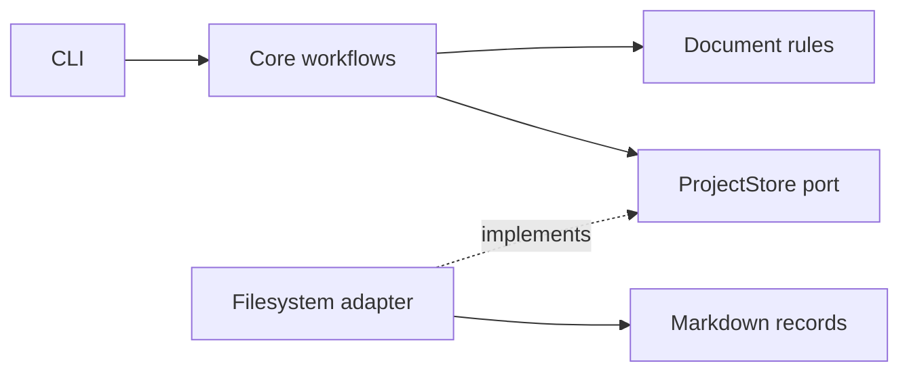

<div align="center">
    <h1>Makespec</h1>
    <strong>A CLI to create, manage, and evolve product & tech decisions and specifications. Craft ADRs. Shape RFCs. Build better software.</strong>
</div>
<br>
<br>

## ✨ Features

- Record small, focused decisions in architecture decision record (ADR) format and write functionality specifications, including product requirements documents (PRDs), in request for comments (RFC) format.
- Compare specification alternatives against functional requirements (FR), non-functional requirements (NFR), and constraints using qualitative labels and PASS/FAIL gates.
- Create proposals, list records, and change status through five CLI commands.
- Keep dated, numbered records in `docs/decisions/` and `docs/specifications/`, and check their structure with `makespec check`.
- Give coding agents the bundled skill so they can create and manage records through the CLI.
- Run locally with a standalone Rust binary: it makes no network or LLM-provider calls and collects no telemetry.

<br>

## 🚀 Usage

### 1. Install the binary

#### Prebuilt binary

Download an archive for your operating system and CPU from [GitHub Releases](https://github.com/adbayb/makespec/releases). You do not need to install Rust.

Verify the archive against the release's `SHA256SUMS`, extract it, and move `makespec` (`makespec.exe` on Windows) to a directory on your `PATH`. Confirm the installation:

```sh
makespec --version
```

If no release is available, build from source using the instructions below.

#### Build from source (alternative)

Install [stable Rust](https://rustup.rs/) and Git, then build and install from a checkout. You need access to this repository to clone it:

```sh
git clone https://github.com/adbayb/makespec.git
cd makespec
cargo install --path . --locked
makespec --version
```

If you already have a checkout, start with `cargo install --path . --locked`.

Cargo's default binary directory is `~/.cargo/bin` on macOS/Linux or `%USERPROFILE%\.cargo\bin` on Windows. Add that directory to your `PATH` if your shell cannot find `makespec`.

### 2. Initialize your project

Run these commands from the repository where you want to keep your records:

```sh
makespec init
makespec check
```

`init` creates both document directories, an accepted "Use Makespec to manage decisions and specifications" decision, and the skill with its templates and command reference under `.agents/skills/makespec/`. When no specifications exist, it adds an empty `docs/specifications/.gitkeep` so Git can track the directory. It creates no specification and preserves existing records. Run all commands from your project root.

### 3. Create and review a record manually

Pass a Markdown body to `new` on stdin, omitting front matter and the ID/title heading. New records start as `proposed`:

```sh
makespec new decision "Keep pull requests focused" <<'EOF'
## Context

Reviewers need changes they can evaluate in one pass.

## Decision

Keep each pull request focused on one change.

## Consequences

Large features may need several pull requests.
EOF

makespec check
makespec list
makespec status ADR-0002 accepted
```

In a fresh project, `init` reserves `ADR-0001`, so this example creates `ADR-0002`. Use the ID from the command output when working in an existing project.

On PowerShell, save the Markdown body above in `decision.md` and pipe it with:

```powershell
Get-Content -Raw decision.md | makespec new decision "Keep pull requests focused"
```

For a specification, use `new specification` and follow the [specification template](.agents/skills/makespec/references/specification-template.md).

Edit records with your editor or agent tools, preserving IDs and dates, then run `makespec check`. See the [command reference](.agents/skills/makespec/references/cli.md) for lifecycle and completion rules.

### 3 (alternative). Specify and implement your project with an AI coding harness

Open your initialized project in an AI coding harness such as GitHub Copilot, Claude Code, or Codex that supports the installed skill. If your harness exposes skills as slash commands, invoke `/makespec` followed by your project idea:

```text
/makespec Create an iOS application that lets users track their daily habits.
```

The agent creates a proposed RFC-format specification in `docs/specifications/`. In interactive sessions, it asks focused questions and waits for answers. In autopilot or explicitly unattended work, it resolves ordinary product gaps with explicit, reversible proposal assumptions. See the [skill workflow](.agents/skills/makespec/SKILL.md#2-resolve-gaps) for clarification rules and genuine blockers. When no specifications exist, the first specification is `RFC-0001`, independent of the adoption decision `ADR-0001` and any cached allocations.

The agent continues clarification and correction until `makespec check` passes before reporting authoring complete. The CLI itself permits incomplete proposals, but they fail checking and cannot be accepted. A passing check confirms structure and completeness rules, not the truth of assumptions or evidence.

Review the specification. Edit it yourself or ask the agent to revise it, or keep it as written. To accept it, validate the records and run:

```sh
makespec check
makespec status RFC-0001 accepted
```

Replace `RFC-0001` with the specification's ID. You can also ask the agent to accept it:

```text
Use makespec to check the records and set RFC-0001 to accepted.
```

Then ask the agent to implement the accepted specification, replacing `<spec-file>` with its filename:

```text
Implement the specification @docs/specifications/<spec-file>
```

### Commands

| Command | Purpose |
| --- | --- |
| `makespec`, `makespec --help`, or `makespec -h` | Print help. |
| `makespec init` | Bootstrap records and the agent skill in the current directory. |
| `makespec new <decision\|specification> "Title"` | Read a Markdown body from stdin and create a proposal. |
| `makespec list` | List all records and their statuses. |
| `makespec status ID STATUS [REPLACEMENT_ID]` | Accept, reject, deprecate, or supersede a record. |
| `makespec check` | Validate front matter, document structure, filenames, lifecycle links, and specification comparison tables. |

Use `makespec --help` or `makespec <command> --help` for command details.

<br>

## 🌍 Ecosystem

### Agent skill and templates

`makespec init` installs the [Makespec skill](.agents/skills/makespec/SKILL.md) and its references under `.agents/skills/makespec/`. Use an agent that discovers this directory, and put the binary on that agent's `PATH`.

The skill guides agents through project-record work. Read its [workflow](.agents/skills/makespec/SKILL.md#workflow) for planning and record-operation boundaries.

### Used technologies

- Rust and Cargo for the binary and build.
- Clap for command parsing.
- YAML front matter and Markdown for records.

<br>

## 🏗️ Architecture

The CLI calls core workflows and document rules through a hexagonal design. The filesystem adapter implements the storage port:



Each document kind has its own incrementing IDs. When no records of a kind exist, its sequence restarts at `0001`. Otherwise, cached counters retain earlier allocations at the same project path, even if you remove records; failed writes can leave gaps. Records contain a date and use YAML front matter as the sole status source. You can review and version the files in Git.

Makespec validates paths and metadata, limits document input to 2 MiB, uses exclusive creation, and checks for external edits before replacing files. It keeps ID allocation locks outside the repository. Advisory locks coordinate Makespec processes but cannot control external editors.

Read [RFC-0001: Makespec product requirements document (PRD)](docs/specifications/0001-makespec-product-requirements-document.md) for the product and implementation specification.

<br>

## ✍️ Contribution

Read [CONTRIBUTING.md](CONTRIBUTING.md) for development setup, conventions, checks, benchmarks, and releases.

<br>

## 📖 License

Licensed under the [MIT License](LICENSE).

<br>
