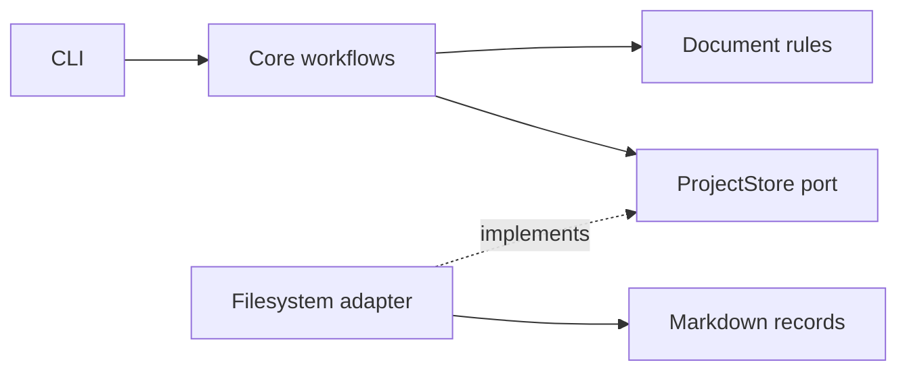

<div align="center">
    <h1>Makespec</h1>
    <strong>Record focused decisions and specify functionality in Markdown.</strong>
</div>
<br>
<br>

## ✨ Features

- Record small, focused decisions with architecture decision records (ADRs) and specify functionality with proposals (RFCs).
- Compare RFC alternatives against functional/non-functional requirements and constraints using qualitative labels and PASS/FAIL gates.
- Create proposals, list records, and change status through five CLI commands.
- Keep dated, numbered records in `docs/adrs/` and `docs/rfcs/`, and check their structure with `makespec check`.
- Give coding agents the bundled skill so they can create and manage records through the CLI.

Makespec runs locally with a standalone Rust binary. It makes no network or LLM-provider calls and collects no telemetry.

<br>

## 🚀 Usage

### 1. Install the binary

#### Prebuilt binary

Download an archive for your operating system and CPU from [GitHub Releases](https://github.com/adbayb/makespec/releases). You do not need to install Rust.

Verify the archive against the release's `SHA256SUMS`, extract it, and move `makespec` (`makespec.exe` on Windows) to a directory on your `PATH`. Confirm the installation:

```sh
makespec --version
```

If no release is available, build from source using the instructions below.

#### Build from source (alternative)

Install [stable Rust](https://rustup.rs/) and Git, then build and install from a checkout. You need access to this repository to clone it:

```sh
git clone https://github.com/adbayb/makespec.git
cd makespec
cargo install --path . --locked
makespec --version
```

If you already have a checkout, start with `cargo install --path . --locked`.

Cargo's default binary directory is `~/.cargo/bin` on macOS/Linux or `%USERPROFILE%\.cargo\bin` on Windows. Add that directory to your `PATH` if your shell cannot find `makespec`.

### 2. Initialize your project

Run these commands from the repository where you want to keep your records:

```sh
makespec init
makespec check
```

`init` creates `docs/adrs/`, `docs/rfcs/`, an accepted adoption ADR, an accepted format RFC, and `.agents/skills/makespec/`. Pass `--no-skills` to skip the skill, or provide a path with `makespec init path/to/project`.

### 3. Create and review a decision

Pass a complete Markdown body to `new` on stdin, omitting front matter and the ID/title heading:

```sh
makespec new adr --title "Keep pull requests focused" <<'EOF'
## Context

Reviewers need changes they can evaluate in one pass.

## Decision

Keep each pull request focused on one change.

## Consequences

Large features may need several pull requests.
EOF

makespec check
makespec list adr --status proposed
makespec status ADR-0002 accepted
```

In a fresh project, `init` reserves `ADR-0001`, so this example creates `ADR-0002`. Use the ID from the command output when working in an existing project.

On PowerShell, save the Markdown body above in `decision.md` and pipe it with:

```powershell
Get-Content -Raw decision.md | makespec new adr --title "Keep pull requests focused"
```

For an RFC, use `new rfc` and complete the [RFC template](.agents/skills/makespec/references/rfc-template.md). Edit proposed Markdown records with your editor or agent tools, preserving their IDs and dates. Run `makespec check` after creating or editing a document, fix reported issues, and rerun the check before changing its status.

### Commands

| Command | Purpose |
| --- | --- |
| `makespec`, `makespec --help`, or `makespec -h` | Print help. |
| `makespec init [PATH] [--no-skills]` | Bootstrap a project. PATH defaults to the current directory. |
| `makespec new adr --title "Title"` | Read a complete ADR body from stdin and create a proposed ADR. Use `rfc` for an RFC. |
| `makespec list [adr\|rfc] [--status STATUS]` | List records and their statuses. |
| `makespec status ID STATUS [--by ID]` | Accept, reject, deprecate, or supersede a record. |
| `makespec check` | Validate front matter, document structure, filenames, lifecycle links, and RFC comparison tables. |

Use `makespec --help` or `makespec <command> --help` for command details.

<br>

## 🌍 Ecosystem

### Agent skill and templates

`makespec init` installs the [Makespec skill](.agents/skills/makespec/SKILL.md) and its references under `.agents/skills/makespec/`. Use an agent that discovers this directory, and put the binary on that agent's `PATH`.

The agent reads relevant accepted records, drafts an [ADR](.agents/skills/makespec/references/adr-template.md) or [RFC](.agents/skills/makespec/references/rfc-template.md), then calls the CLI to create and check the proposal. The [planning guide](.agents/skills/makespec/references/planning.md) describes the approval boundaries. The CLI does not call an LLM or execute instructions from document contents.

### Used technologies

- Rust and Cargo for the binary and build.
- Clap for command parsing.
- YAML front matter and Markdown for records.

<br>

## 🏗️ Architecture

The CLI calls core workflows and document rules through a hexagonal design. The filesystem adapter implements the storage port:



Each document kind has its own incrementing IDs. Records contain a date and use YAML front matter as the sole status source. You can review and version the files in Git.

Makespec validates paths and metadata, limits document input to 2 MiB, uses exclusive creation, and checks for external edits before replacing files. It keeps ID allocation locks outside the repository. Advisory locks coordinate Makespec processes but cannot control external editors.

Read [`docs/spec.md`](docs/spec.md) for the product and implementation specification.

<br>

## ✍️ Contribution

Read [CONTRIBUTING.md](CONTRIBUTING.md) for development setup, conventions, checks, benchmarks, and releases.

<br>

## 📖 License

Licensed under the [MIT License](LICENSE).

<br>
